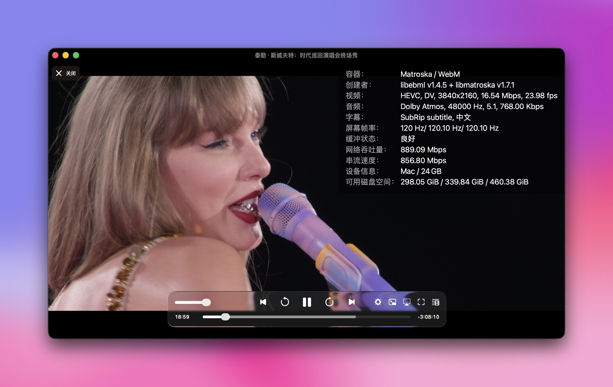

+++
"title" = "最近的折腾日记"
"date" = "2026-01-28"
"description" = ""
"summary" = ""
"tags" = ["树莓派", "Emby", "115网盘", "Cloudflare"]
"categories" = ["Logs"]
"draft" = false
"series" = []

[params]
"ShowToc" = true
"showReadingTime" = true

[params.cover]
  image = "featured.jpg"
+++
最终效果：实现了在极低的配置里运行媒体库，媒体库支持4k蓝光原盘视频播放，可以做到秒开，支持全国任何有网的地点访问，播放时服务器负载极低，见图2。

最近想看霉霉时代巡演的终场秀了，但是发现原盘下载下来得20G，下载下来之后在infuse里打开后感觉发现了新世界，里面的媒体库孤零零的只有霉霉的海报，空荡荡的让人想一点点填上自己喜欢的片子。恰好一直想看绝命毒师，想着把绝命毒师也先下载下来加进去吧，结果找到的绝命毒师4k原盘全集得1700G，彻底打消了下载到本地的念头，毕竟媒体库里的文件要是看完就删了就显示不出来了。

于是我在搜寻一些解决方案，最开始我有两套思路，一种是本地搭建nas里面建立媒体库；另一种是云端网盘存储资源然后从云端事时读取数据。

第一种的方案大概计算了一下，由于硬盘内存涨价，光硬盘+内存成本就得2000-3000元，果断放弃

第二种方案和第一种方案很像，相当于无盘nas，尤其是网盘挂载特有的strm文件，相当于在本地存一个网盘上视频的快捷方式，点击快捷方式即可播放，完全不占用本地空间

那么就该选择网盘了，果断选择115网盘，拥有最多的磁力库资源，并且无限制带宽，一年100的价格，还有40T的容量（必须一次开通8年才有这个价格，不过115都运营17年了，不怕跑路，能用2-3年就可以回本了）

硬件方面选择在我一年前买的树莓派5上运行，买了之后吃灰了一年现在终于可以重见天日了，并且在成功部署之后这个项目甚至可以在树莓派3上运行。

整个方案由openlist+taosync+emby+mihomo+matecubexd+medialinker+cloudflared这些项目组成，主要实现了将云端数据挂载到本地并生成strm文件（openlist+taosync），媒体库本体的搭建（emby+mihomo+metacubexd），反向代理emby实现服务器极低带宽的情况下播放视频（medialinker）。

这就是大概媒体库的搭建情况，然后当我在写博客的时候，阿里云给我发信息说我的域名又要到期了，阿里云真几把黑啊，xyz后缀的域名收我125一个年，我续费个🥚，但是笔记里的图床服务必须得有域名啊，于是果断转站cloudflare

我仿佛发现了新世界的大门，cloudflare的com后缀的域名首年10刀，续费也10刀，那不无敌了，果断注册一个，而且他不用备案！阿里云注册一个域名的流程be like：填申请书、打印下来、签字、拍视频举着身份证念保证协议、上传、然后等7-14天审核😄，而且你必须得在阿里云有一台服务器，这还得你妈花钱

注册完毕之后先把图床迁移一下，然后我又发现，cloudflare为个人用户提供免费的10G的存储空间，每个月100万次以内的A/B请求免费，那我之前为什么一直在阿里云续费10块一年的图床服务。

我发现，cloudflare竟然免费给我的域名配了ssl证书（阿里云你还是得掏钱租），然后继续配置防火墙之类的，毕竟大家对cloudflare认识最多的就是这个。

写完博客后，我问Gemini cloudflare还有没有我没有白嫖到的服务，结果当然有了，他提供免费的tunnel穿透，可以完美的实现在外面访问家里的服务器，避免了服务器直接暴露在公网里面（而且我也没有公网ip），cloudflare的免费tunnel穿透服务严禁穿透服务用于视频播放和大文件下载（流量费确实贵啊），但是这套方案的优势就在于，服务器只是把strm文件传给了手机，手机自己去网盘服务器读取视频信息，实现了几乎0流量穿透出去，经过我的一番配置，现在我的emby也支持在外面访问了

测试一下，码率甚至可以到达124Mbps（和片源有很大关系，此为播放52G一集的绝命毒师时测试的数据），平时观看短视频的码率一般在1-2Mbps，效果碾压

后来又担心当前树莓派的sd卡承受不住这种服务，因为emby服务运行时会从卡里频繁写入用户当前的播放进度，运行日志等内容，sd卡最怕的就是这种高频次和小文件写入了，而且由于sd卡读取速度很慢，在用户滚动媒体库时，海报加载有延迟

于是我考虑将树莓派的存储方案改一下，绝对不能使用sd卡，而树莓派5最大的更新就是有了pcie接口，那么就好办了，买一块树莓派的pcie转nvme的板子，再买一块拆机固态硬盘

在挑选板子的时候，我发现了个很好玩的东西，pironman 5，一款树莓派的小机箱

最吸引我的地方是他配了一个塔式散热器给树莓派，之前的方案运行的时候，树莓派自带的散热风扇都转满了还是烫手，塔式散热器可以很好的解决这个问题

其次他的机箱里自带了一块pcie转nvme的板子，不用我自己再买一块了

而且这个小机箱很迷你，上面有块小的oled显示器可以显示当前的系统状态

今天机箱刚到，组装完毕后cpu温度确实下来了，但是买的硬盘还没到，等明天到了再说吧

搭此服务的最小成本：2核2G的arm架构的机器（100-200元，记得买自带emmc存储的设备，sd不耐用）+网盘会员。剩下的域名、机箱、风扇都是增值服务

后续的折腾计划：

- 硬盘到了之后把硬盘装上去，然后把系统从sd卡迁移到硬盘里

- 配置软路由来跑魔法服务，实现PC端0代理软件上网，实现树莓派也不需要再开代理拉镜像了 ，实现switch加速器？（我都好久没打开switch了，而且联机的喷3都出掉了）

从1.28号到今天，一周的时间折腾了一堆东西，还没折腾结束，然后才想起来我刚开始的目的是看霉霉新电影啊，都忘了，拿出来看了一个chapter，她真的好漂亮，如图哈哈

