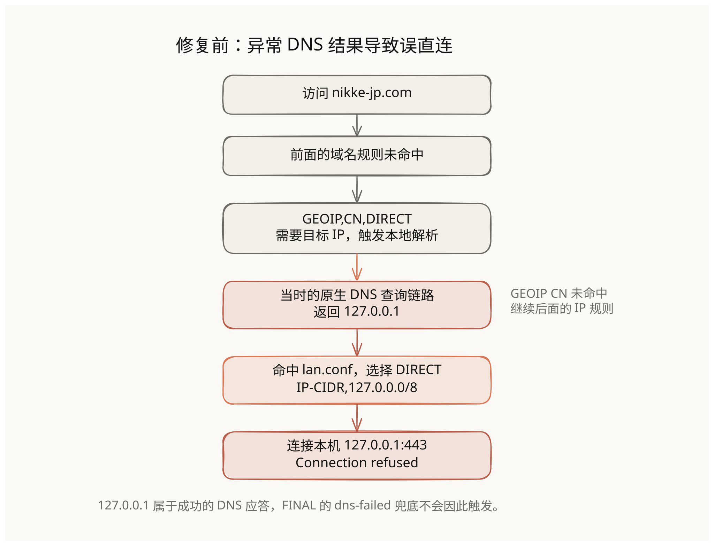
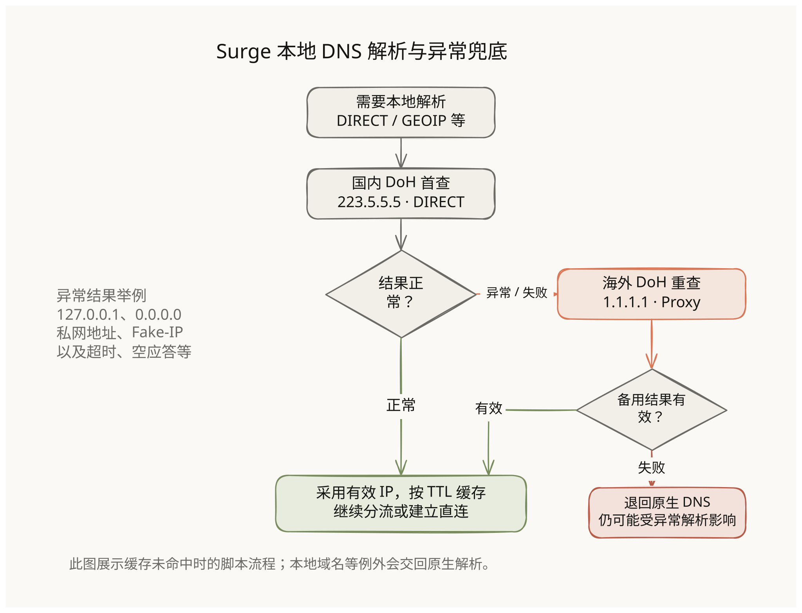

+++
"title" = "Tracking Down a Gap in My Surge Rules"
"date" = "2026-11-22T19:08:54+08:00"
"draft" = false
"description" = ""
"summary" = ""
"tags" = []
"categories" = []
"series" = []

[params]
"showReadingTime" = true
+++
# There was a gap in the rules I'd been using

I've always used [Sukka](https://skk.moe/)'s [rule sets](https://blog.skk.moe/post/i-have-my-unique-Surge-setup/) with Surge. One little problem kept cropping up. When I played overseas games like NIKKE, some resources wouldn't load, or I couldn't get into the game at all.

I figured some traffic was going down the wrong route. But a single game process talks to so many domains and fetches so many resources that I'd have to capture its traffic, figure out which domain was going the wrong way, and write a rule for it by hand. In earlier versions of Surge, capturing traffic for a particular process and turning it into a rule set was enough of a hassle that I never bothered. I'd just switch to global proxy mode when I wanted to play.

Later I found that some sites wouldn't open in my browser either. I had to add a rule by hand to get each site to load through the proxy.

That seemed odd. As I remembered it, Sukka's rules sent everything through the proxy except the Chinese sites covered by the rules.

So why couldn't I reach those sites?

---
# What's new in Surge

In the [6.9.0 update](https://nsSurge.com/blog/Surge-cli-updates-2/), Surge improved the troubleshooting features in its CLI and skill. An AI agent can now use them to troubleshoot automatically, which makes problems like this easier to sort out.

---

# Why the connection failed

When I tried getting an AI to look into why NIKKE couldn't connect again, the first thing that stood out was that some domains were matching the `lan.conf` rule set. I'll use https://nikke-jp.com as the example.

In the Surge Dashboard, I saw that DNS had resolved the domain to `127.0.0.1`. I double-checked on [IT-DOG](https://www.itdog.cn/) and confirmed it was a textbook case of DNS poisoning. It's one of the ways the GFW blocks access to particular sites, by returning an incorrect DNS answer.

Here's where that answer and my rules interacted in a way I hadn't expected.

```ini
[Rule]
...
# 一些常见的国内外域名分流规则
...
...
# IP 归属地为 CN 的走直连
GEOIP,CN,DIRECT
# 局域网 IP 规则
RULE-SET,https://ruleset.skk.moe/List/ip/lan.conf,DIRECT

# 匹配失败
FINAL,Proxy,dns-failed
```

The domain rules I was using couldn't cover every Chinese and overseas site, so I'd added `GEOIP,CN,DIRECT` as a fallback to send traffic to sites with a Chinese IP over a direct connection. In the process, Surge also looked up `nikke-jp.com`. The poisoned answer was `127.0.0.1`, which happened to match the next rule, `lan.conf`. Surge tried to connect directly, and the connection failed.



---

# When Surge resolves a domain locally

It's easy enough to fix an individual domain by assigning it the right policy by hand. But that only fixes the symptom.

The problem comes down to the difference between remote and local DNS resolution. To get to the bottom of it, I first had to figure out when Surge actually triggers a local lookup.

Reading through the [Surge docs](https://kb.nsSurge.com/Surge-knowledge-base/technotes/dns), I found that Surge triggers local DNS resolution in the following cases:

- When the rule selects a direct connection.
- When an IP-based rule such as `IP-CIDR`, `IP-CIDR6`, `GEOIP`, or `IP-ASN` needs the domain's IP address and doesn't have the `no-resolve` flag.
- When the policy's own host is specified as a domain name. That name is resolved locally.

>[!note]+ About the `no-resolve` flag
>Surge checks rules from top to bottom. When a domain rule matches and selects a non-direct policy, DNS resolution happens on the remote end.
>
>As Surge works through the rule set, it may reach an IP rule such as `IP-CIDR, 123.123.123.123, Proxy`. If it hasn't resolved the domain yet, it does a local DNS lookup and checks the resulting IP address against the rule.
>
>That's what the `no-resolve` flag is for. With this flag on an IP rule, if Surge hasn't resolved the domain yet, it skips the rule and moves on to the next one without doing a local DNS lookup. If Surge already has an IP address for the domain, it checks that address against the rule.

---

# Two ways to fix it

## Do all DNS lookups remotely

You can do all DNS lookups on the remote end. That prevents both DNS leaks and DNS poisoning.

The downside is that Chinese video and download sites will pick CDN nodes based on the remote resolver's location, which can really slow things down.

## Use a script for DNS lookups

Another option is to change how local lookups work. In the [manual](https://manual.nsSurge.com/scripting/dns.html), I found that Surge can handle DNS lookups with a script. That lets me set up local resolution like this:



When the Chinese resolver returns a poisoned answer, the script makes a second lookup using an overseas DNS-over-HTTPS (DoH) resolver. It reaches that resolver through the proxy to make sure the request gets through.

Here's the script:

```js
/*
 * Surge type=dns script. IPv4 only, matching the current ipv6=false profile.
 * Primary: AliDNS HTTPS, DIRECT. Fallback: Cloudflare HTTPS, Proxy.
 * Suggested declaration (example path must be replaced with the real path):
 * [Script]
 * dns-fallback = type=dns,script-path=/path/to/dns-fallback.js,timeout=8
 * [Host]
 * * = script:dns-fallback
 * Keep specific internal DNS/Host mappings ABOVE the wildcard entry.
 * If both resolvers fail, $done({}) delegates back to Surge's configured DNS.
 * That last-resort path can return the original polluted answer.
 */

var DNS_CONFIG = {
    primaryURL: "https://223.5.5.5/resolve",
    primaryPolicy: "DIRECT",
    primaryTimeout: 2,
    fallbackURL: "https://1.1.1.1/dns-query",
    fallbackPolicy: "Proxy",
    fallbackTimeout: 4,
    maximumTTL: 300
};

function normalizeName(name) {
    return String(name).toLowerCase().replace(/\.$/, "");
}

function parseIPv4(address) {
    if (!/^\d{1,3}(\.\d{1,3}){3}$/.test(address)) {
        return null;
    }
    var parts = address.split(".").map(Number);
    return parts.every(function (part) { return part <= 255; }) ? parts : null;
}

function isPublicIPv4(address) {
    var parts = parseIPv4(address);
    if (!parts) {
        return false;
    }
    var first = parts[0];
    var second = parts[1];
    var third = parts[2];
    return !(first === 0 || first === 10 || first === 127 || first >= 224 ||
        (first === 100 && second >= 64 && second <= 127) ||
        (first === 169 && second === 254) ||
        (first === 172 && second >= 16 && second <= 31) ||
        (first === 192 && second === 168) ||
        (first === 192 && second === 0 && third === 2) ||
        (first === 198 && (second === 18 || second === 19)) ||
        (first === 198 && second === 51 && third === 100) ||
        (first === 203 && second === 0 && third === 113));
}

function useNativeDNS(domain) {
    // Leave local discovery and reverse lookups with the original resolver.
    return domain.indexOf(".") < 0 || parseIPv4(domain) !== null ||
        domain.indexOf(":") >= 0 ||
        /(^|\.)(localhost|local|home\.arpa|in-addr\.arpa|ip6\.arpa)$/.test(domain);
}

function readAnswer(body, domain) {
    var response = JSON.parse(body);
    if (response.Status !== 0 || response.TC === true || !Array.isArray(response.Answer)) {
        throw new Error("DNS status=" + response.Status + ", missing or truncated answer");
    }

    var records = response.Answer;
    var currentName = domain;
    var visited = [];
    var ttl = DNS_CONFIG.maximumTTL;

    // Follow only this question's CNAME chain, excluding unrelated A records.
    while (true) {
        if (visited.indexOf(currentName) >= 0 || visited.length >= 16) {
            throw new Error("CNAME loop or excessive chain length");
        }
        visited.push(currentName);
        var matching = records.filter(function (record) {
            return normalizeName(record.name) === currentName;
        });
        var addresses = matching.filter(function (record) { return record.type === 1; });
        if (addresses.length > 0) {
            var unique = [];
            addresses.forEach(function (record) {
                if (!isPublicIPv4(record.data)) {
                    throw new Error("non-public or invalid IPv4 answer: " + record.data);
                }
                ttl = Math.min(ttl, readTTL(record.TTL));
                if (unique.indexOf(record.data) < 0) {
                    unique.push(record.data);
                }
            });
            return { addresses: unique, ttl: ttl };
        }
        var aliases = matching.filter(function (record) { return record.type === 5; });
        if (aliases.length !== 1 || typeof aliases[0].data !== "string") {
            throw new Error("no IPv4 address or complete CNAME chain");
        }
        ttl = Math.min(ttl, readTTL(aliases[0].TTL));
        currentName = normalizeName(aliases[0].data);
    }
}

function readTTL(value) {
    if (typeof value !== "number" || !isFinite(value) || value < 0) {
        throw new Error("invalid DNS TTL");
    }
    return Math.floor(value);
}

function queryResolver(url, policy, timeout, domain, callback) {
    try {
        $httpClient.get({
            url: url + "?name=" + encodeURIComponent(domain) + "&type=A",
            headers: { Accept: "application/dns-json" },
            policy: policy,
            timeout: timeout,
            "auto-redirect": false,
            "auto-cookie": false
        }, function (error, response, body) {
            var result;
            try {
                if (error || !response || Number(response.status) !== 200) {
                    throw new Error(error || "HTTP status=" + (response && response.status));
                }
                result = readAnswer(body, domain);
            } catch (failure) {
                callback(String(failure), null);
                return;
            }
            callback(null, result);
        });
    } catch (failure) {
        callback(String(failure), null);
    }
}

function main() {
    var domain = normalizeName($domain);
    if (useNativeDNS(domain)) {
        $done({});
        return;
    }

    queryResolver(DNS_CONFIG.primaryURL, DNS_CONFIG.primaryPolicy,
        DNS_CONFIG.primaryTimeout, domain, function (error, result) {
            if (!error) {
                $done(result);
                return;
            }
            console.log("[dns-fallback] " + domain + " primary failed: " + error);
            queryResolver(DNS_CONFIG.fallbackURL, DNS_CONFIG.fallbackPolicy,
                DNS_CONFIG.fallbackTimeout, domain, function (fallbackError, fallbackResult) {
                    if (fallbackError) {
                        console.log("[dns-fallback] " + domain +
                            " fallback failed; delegating to native DNS: " + fallbackError);
                        $done({});
                        return;
                    }
                    console.log("[dns-fallback] " + domain + " recovered via " +
                        DNS_CONFIG.fallbackPolicy + ": " + fallbackResult.addresses.join(", "));
                    $done(fallbackResult);
                });
        });
}

main();

```

Here's how I reference the script in my Surge config:

```ini
[Host]
* = script:dns-fallback

[Script]
dns-fallback = type=dns,script-path={path-to-file}/dns-fallback.js,timeout=8
```

---

# Where the script falls short

The second approach can't prevent DNS leaks. When a local lookup is triggered, there are overseas domains the Chinese resolver can resolve just fine, so the query leaks. Whenever a request reaches `GEOIP,CN` and triggers a fresh lookup, the script asks AliDNS over DoH first. If the domain resolves normally in China, Surge uses that answer to make its routing decision. Even if the request ends up going through `Proxy` and the proxy server does another lookup, that first query has already happened.

## How to fix that

The simple fix:

- If DNS leaks are a particular concern for you, go with the first approach and resolve all domains remotely.

If you're up for a bit more tinkering, you can assign a DNS server to a rule set for Chinese domains and use an overseas DoH resolver as the fallback. That way, the usual Chinese domains go to a Chinese resolver, and anything outside the rule set goes to the overseas resolver. Depending on the IP it returns, a GEOIP rule can still send the connection directly to a site in China. The only downside is that you can still end up with a CDN node in the wrong location, though that's much less of a problem than with the first approach. The usual Chinese domain rule sets already cover most cases where you want a nearby CDN, like streaming, cloud storage, and game downloads.
