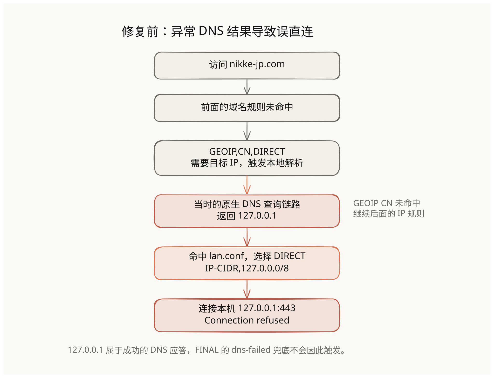
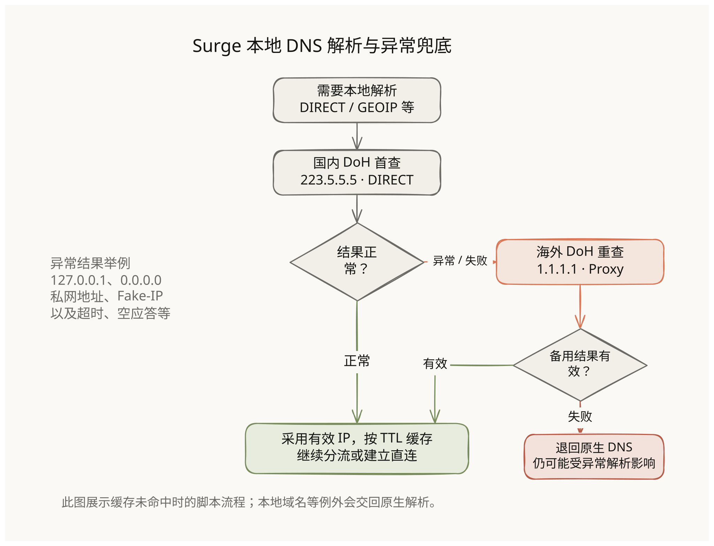

+++
"title" = "一次 Surge 规则漏洞排障"
"date" = "2026-11-22T19:08:54+08:00"
"draft" = false
"description" = ""
"summary" = ""
"tags" = []
"categories" = []
"series" = []

[params]
"showReadingTime" = true
+++
# 原先的规则集一直有漏洞

我Surge一直用的是[Sukka大佬](https://skk.moe/)的[规则集](https://blog.skk.moe/post/i-have-my-unique-Surge-setup/)，使用途中一直有点小问题，具体表现为：玩NIKKE等国外游戏的时候，无法加载某些资源/无法进入游戏。

我想是有些规则没有做好分流，但是一个游戏进程，访问的域名和资源太多了，要判断哪个域名分流失败，就得抓包来手动分流，而在之前的Surge里，想要对进程抓包来创立规则集还很麻烦，我也就一直没管，玩游戏的时候直接开全局代理。

后面我发现，有些网站浏览器也进不去，我得手动添加规则让这个网站走代理才能访问。

这就很奇怪了，我记得Sukka大佬的规则是除了规则里的国内网站，剩下的网站一律走代理啊。

那为什么会访问不了？

---
# Surge的新功能

在Surge的[6.9.0的更新](https://nsSurge.com/blog/Surge-cli-updates-2/)中，Surge加强了Cli和skill的排障功能，现在AI agent可以使用Surge提供的Cli和skill来进行自动排障了，让解决问题变得容易起来。

---

# 无法访问的根本原因

再尝试让AI分析为什么NIKKE无法连接，发现的最表层的现象就是有些域名（后文以https://nikke-jp.com为例）走的规则集是`lan.conf`。

接下来在Surge Dashboard里发现，域名被DNS解析为`127.0.0.1`，在[IT-DOG](https://www.itdog.cn/)二次检查之后，确认这就是标准的DNS污染。这是一种GFW的阻断手段，通过DNS返回错误结果实现特定的网站无法访问。

而解析出来的结果与我的规则又发生了奇妙的化学反应：

```ini
[Rule]
...
# 一些常见的国内外域名分流规则
...
...
# IP 归属地为 CN 的走直连
GEOIP,CN,DIRECT
# 局域网 IP 规则
RULE-SET,https://ruleset.skk.moe/List/ip/lan.conf,DIRECT

# 匹配失败
FINAL,Proxy,dns-failed
```

在上述我使用的规则中，因为常见的国内外域名不可以做到100%分流，于是在后面加了兜底策略`GEOIP,CN,DIRECT`，让 CN 的网站都走直连，但是在这个过程中，`nikke-jp.com`也被解析了，且结果被污染，返回了`127.0.0.1`，又刚好命中了后面的`lan.conf`规则走直连，于是访问失败了。



---

# Surge的DNS解析规则

解决这个问题也很简单，为分流错误的域名手动指定策略即可，但是这终究是治标不治本。

上面的问题主要出在远端DNS和本地DNS解析的差别上，要解决这个问题，首先得搞明白，在Surge工作的时候，什么时候会触发本地DNS解析。

翻阅了[Surge文档](https://kb.nsSurge.com/Surge-knowledge-base/technotes/dns)后，Surge触发本地DNS解析分为下面几种情况：

- 规则策略为直连时
- 特定IP规则，如`IP-CIDR`, `IP-CIDR6`, `GEOIP`, `IP-ASN`等需要获取域名的IP时且未加`no-resolve`字段。
- 策略本身的主机名为域名时，该域名会走本地DNS解析

>[!note]+ 关于`no-resolve`字段
>Surge的规则匹配是自上而下匹配的，域名匹配成功时，如果是非直连策略，则DNS解析在远端发生。
>
>而在规则集的匹配过程中，有时会匹配到IP规则，比如`IP-CIDR, 123.123.123.123, Proxy`，如果此时域名还未解析出IP地址，则为了验证域名是否对应的是这个IP，Surge会发生本地DNS解析，解析出来的结果来判断这个IP规则是否发生命中。
>
>而`no-resolve`字段就是为了避免这个事情发生，在IP规则后面加了这个字段后，判断这个规则是否命中时，如果域名尚未被解析，不进行本地DNS解析，直接跳过该规则继续匹配后续规则。如果域名已经被解析出IP地址，则按照IP地址规则判断是否命中

---

# 解决问题的方法有两种

## 所有DNS解析放到远端

可以将所有的DNS解析都放在远端，这样既可以防止DNS泄漏，也可以防止DNS污染

但是这样的话，国内视频/下载网站的CDN节点的地址会按照远端的地址进行匹配，极大影响访问速率

## DNS脚本解析

修改本地DNS解析的流程，通过[手册](https://manual.nsSurge.com/scripting/dns.html)，发现Surge支持DNS解析通过脚本进行，可以让本地DNS解析的逻辑变成这样：



当国内DNS发生了DNS污染时，则二次解析，由海外的DoH进行查询，且为了保证成功访问，使用代理访问DoH。

具体脚本为：

```js
/*
 * Surge type=dns script. IPv4 only, matching the current ipv6=false profile.
 * Primary: AliDNS HTTPS, DIRECT. Fallback: Cloudflare HTTPS, Proxy.
 * Suggested declaration (example path must be replaced with the real path):
 * [Script]
 * dns-fallback = type=dns,script-path=/path/to/dns-fallback.js,timeout=8
 * [Host]
 * * = script:dns-fallback
 * Keep specific internal DNS/Host mappings ABOVE the wildcard entry.
 * If both resolvers fail, $done({}) delegates back to Surge's configured DNS.
 * That last-resort path can return the original polluted answer.
 */

var DNS_CONFIG = {
    primaryURL: "https://223.5.5.5/resolve",
    primaryPolicy: "DIRECT",
    primaryTimeout: 2,
    fallbackURL: "https://1.1.1.1/dns-query",
    fallbackPolicy: "Proxy",
    fallbackTimeout: 4,
    maximumTTL: 300
};

function normalizeName(name) {
    return String(name).toLowerCase().replace(/\.$/, "");
}

function parseIPv4(address) {
    if (!/^\d{1,3}(\.\d{1,3}){3}$/.test(address)) {
        return null;
    }
    var parts = address.split(".").map(Number);
    return parts.every(function (part) { return part <= 255; }) ? parts : null;
}

function isPublicIPv4(address) {
    var parts = parseIPv4(address);
    if (!parts) {
        return false;
    }
    var first = parts[0];
    var second = parts[1];
    var third = parts[2];
    return !(first === 0 || first === 10 || first === 127 || first >= 224 ||
        (first === 100 && second >= 64 && second <= 127) ||
        (first === 169 && second === 254) ||
        (first === 172 && second >= 16 && second <= 31) ||
        (first === 192 && second === 168) ||
        (first === 192 && second === 0 && third === 2) ||
        (first === 198 && (second === 18 || second === 19)) ||
        (first === 198 && second === 51 && third === 100) ||
        (first === 203 && second === 0 && third === 113));
}

function useNativeDNS(domain) {
    // Leave local discovery and reverse lookups with the original resolver.
    return domain.indexOf(".") < 0 || parseIPv4(domain) !== null ||
        domain.indexOf(":") >= 0 ||
        /(^|\.)(localhost|local|home\.arpa|in-addr\.arpa|ip6\.arpa)$/.test(domain);
}

function readAnswer(body, domain) {
    var response = JSON.parse(body);
    if (response.Status !== 0 || response.TC === true || !Array.isArray(response.Answer)) {
        throw new Error("DNS status=" + response.Status + ", missing or truncated answer");
    }

    var records = response.Answer;
    var currentName = domain;
    var visited = [];
    var ttl = DNS_CONFIG.maximumTTL;

    // Follow only this question's CNAME chain, excluding unrelated A records.
    while (true) {
        if (visited.indexOf(currentName) >= 0 || visited.length >= 16) {
            throw new Error("CNAME loop or excessive chain length");
        }
        visited.push(currentName);
        var matching = records.filter(function (record) {
            return normalizeName(record.name) === currentName;
        });
        var addresses = matching.filter(function (record) { return record.type === 1; });
        if (addresses.length > 0) {
            var unique = [];
            addresses.forEach(function (record) {
                if (!isPublicIPv4(record.data)) {
                    throw new Error("non-public or invalid IPv4 answer: " + record.data);
                }
                ttl = Math.min(ttl, readTTL(record.TTL));
                if (unique.indexOf(record.data) < 0) {
                    unique.push(record.data);
                }
            });
            return { addresses: unique, ttl: ttl };
        }
        var aliases = matching.filter(function (record) { return record.type === 5; });
        if (aliases.length !== 1 || typeof aliases[0].data !== "string") {
            throw new Error("no IPv4 address or complete CNAME chain");
        }
        ttl = Math.min(ttl, readTTL(aliases[0].TTL));
        currentName = normalizeName(aliases[0].data);
    }
}

function readTTL(value) {
    if (typeof value !== "number" || !isFinite(value) || value < 0) {
        throw new Error("invalid DNS TTL");
    }
    return Math.floor(value);
}

function queryResolver(url, policy, timeout, domain, callback) {
    try {
        $httpClient.get({
            url: url + "?name=" + encodeURIComponent(domain) + "&type=A",
            headers: { Accept: "application/dns-json" },
            policy: policy,
            timeout: timeout,
            "auto-redirect": false,
            "auto-cookie": false
        }, function (error, response, body) {
            var result;
            try {
                if (error || !response || Number(response.status) !== 200) {
                    throw new Error(error || "HTTP status=" + (response && response.status));
                }
                result = readAnswer(body, domain);
            } catch (failure) {
                callback(String(failure), null);
                return;
            }
            callback(null, result);
        });
    } catch (failure) {
        callback(String(failure), null);
    }
}

function main() {
    var domain = normalizeName($domain);
    if (useNativeDNS(domain)) {
        $done({});
        return;
    }

    queryResolver(DNS_CONFIG.primaryURL, DNS_CONFIG.primaryPolicy,
        DNS_CONFIG.primaryTimeout, domain, function (error, result) {
            if (!error) {
                $done(result);
                return;
            }
            console.log("[dns-fallback] " + domain + " primary failed: " + error);
            queryResolver(DNS_CONFIG.fallbackURL, DNS_CONFIG.fallbackPolicy,
                DNS_CONFIG.fallbackTimeout, domain, function (fallbackError, fallbackResult) {
                    if (fallbackError) {
                        console.log("[dns-fallback] " + domain +
                            " fallback failed; delegating to native DNS: " + fallbackError);
                        $done({});
                        return;
                    }
                    console.log("[dns-fallback] " + domain + " recovered via " +
                        DNS_CONFIG.fallbackPolicy + ": " + fallbackResult.addresses.join(", "));
                    $done(fallbackResult);
                });
        });
}

main();

```

Surge配置里引用脚本：

```ini
[Host]
* = script:dns-fallback

[Script]
dns-fallback = type=dns,script-path={path-to-file}/dns-fallback.js,timeout=8
```

---

# 脚本方法的缺陷

方法二无法避免DNS泄漏，因为触发本地DNS解析的时候，会存在一些国外地址，国内DNS也能成功解析，导致DNS泄漏。只要请求走到 `GEOIP,CN` 并触发一次新的解析，脚本就会先问阿里 DoH。域名在国内能正常解析时，这个结果会直接用于分流判断。即使最终走 `Proxy`、代理服务器再解析一次，第一次查询也已经发生了。

## 解决方法

解决方法也很简单：

- 如果你特别在意DNS泄漏，则使用方法一即可，所有域名统一在远端解析。

更折腾的：可以为国内域名规则集指定DNS服务器，最后兜底一个国外DoH策略，这样常规的国内地址走国内DNS解析，未命中规则集的域名走国外DoH解析，而解析出来的IP也可能根据GEOIP规则走国内直连，唯一的缺点就是可能会出现CDN地址定位错误，但是相比方法一已经有很大的缓解。常见的国内地址规则集已经包含了大部分的需要国内CDN加速的场景，如流媒体、网盘、游戏下载场景。
